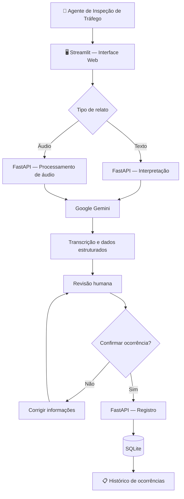

# 🛣️ ROUTE AI

### Intelligent Road Operations Assistant

**Assistente inteligente para operações rodoviárias, utilizando Inteligência Artificial Generativa para transformar relatos por voz ou texto em registros estruturados de ocorrências.**


> **Status:** MVP funcional | Desenvolvimento acadêmico  
> **Contexto:** Challenge FIAP × Motiva — Generative AI  
> **Área:** AI Engineering · Generative AI · Backend Development

---

## 📌 Sobre o projeto

O **ROUTE AI** é um protótipo de assistente inteligente desenvolvido para apoiar profissionais de inspeção de tráfego no registro de ocorrências rodoviárias.

Durante uma operação, esses profissionais precisam identificar situações, comunicar informações e registrar dados relevantes. A interação com sistemas tradicionais pode exigir digitação e navegação por diferentes telas.

Nossa proposta é simplificar parte desse processo: o profissional descreve uma ocorrência **por voz ou texto**, a IA interpreta o relato e organiza as informações para revisão e registro.

**A IA auxilia o profissional, mas a decisão final permanece humana.**

## 🎯 Objetivo

Transformar relatos em linguagem natural em registros estruturados, identificando automaticamente:

- **Rodovia**
- **Quilômetro**
- **Sentido**
- **Descrição da ocorrência**

A solução foi projetada para reduzir a necessidade de preenchimento manual e criar uma base para futuras funcionalidades de apoio operacional.

## 💡 Como funciona?

**Exemplo de relato:**

> "Estou na Rodovia Anhanguera, quilômetro 35, sentido capital. Encontrei um carro parado no acostamento."

**Resultado estruturado pela IA:**

```json
{
  "rodovia": "Rodovia Anhanguera",
  "km": 35.0,
  "sentido": "Capital",
  "descricao": "Carro parado no acostamento"
}
```

Os dados são apresentados em um formulário editável. O usuário pode corrigir informações antes de confirmar o registro.

**Fluxo:** Relato → Interpretação com IA → Revisão humana → Confirmação → Banco de dados.

---

## ✅ Funcionalidades implementadas

| Funcionalidade | Status |
|---|---|
| Interpretação de ocorrências por texto | ✅ |
| Gravação de áudio pelo navegador | ✅ |
| Upload de arquivos de áudio | ✅ |
| Transcrição de áudio com IA | ✅ |
| Extração estruturada de informações | ✅ |
| Revisão e correção dos campos | ✅ |
| Confirmação humana obrigatória | ✅ |
| Armazenamento com SQLite | ✅ |
| Histórico de ocorrências | ✅ |
| Fallback entre modelos Gemini | ✅ |
| Indicador visual de processamento | ✅ |

### 🎙️ Processamento inteligente de áudio

O ROUTE AI utiliza o **Google Gemini** para transcrever e interpretar relatos em uma única chamada por modelo.

Para aumentar a disponibilidade, foi implementado um mecanismo de fallback:

- **Modelo principal:** Gemini 3.8 Flash.
- **Modelo alternativo:** Gemini 3.7 Flash.

Caso o modelo principal apresente uma falha tratada pelo sistema, o processamento pode ser direcionado ao modelo alternativo.

Esse mecanismo foi validado em testes com indisponibilidade temporária do modelo principal.

---

## 🏗️ Arquitetura da solução

A aplicação utiliza uma arquitetura cliente-servidor, separando interface, backend, inteligência artificial e persistência de dados.



### Responsabilidade dos componentes

| Tecnologia | Responsabilidade |
|---|---|
| **Streamlit** | Interface web e interação com o usuário |
| **FastAPI** | Endpoints, processamento e integração |
| **Google Gemini** | Transcrição e extração de informações |
| **Pydantic** | Estruturação e validação de dados |
| **SQLite** | Persistência das ocorrências |
| **Requests** | Comunicação entre frontend e backend |

---

## 📁 Estrutura do projeto

```text
ROUTE-AI/
│
├── app/
│   ├── __init__.py
│   ├── main.py
│   ├── ai_service.py
│   ├── voice_service.py
│   └── database.py
│
├── streamlit_app.py
├── requirements.txt
├── .gitignore
└── README.md
```

**Arquivos locais não versionados:** `.env`, `.venv/` e `route_ai.db`.

---

## 🚀 Executando localmente

### Pré-requisitos

- Python instalado.
- Chave de API do Google Gemini.
- Git.

**1. Clone o repositório**

```bash
git clone https://github.com/jtozzatti/ROUTE-AI.git
cd ROUTE-AI
```

**2. Crie e ative o ambiente virtual**

```bash
python -m venv .venv
```

Windows (PowerShell):

```powershell
.\.venv\Scripts\Activate.ps1
```

**3. Instale as dependências**

```bash
pip install -r requirements.txt
```

**4. Configure as variáveis de ambiente**

Crie um arquivo `.env` na raiz do projeto:

```env
GEMINI_API_KEY=sua_chave_aqui
```

**5. Inicie o backend**

```bash
uvicorn app.main:app --reload
```

API: `http://127.0.0.1:8000`  
Documentação Swagger: `http://127.0.0.1:8000/docs`

**6. Inicie a interface**

Em outro terminal, com o ambiente virtual ativado:

```bash
streamlit run streamlit_app.py
```

Aplicação: `http://localhost:8501`

---

## 🔌 Endpoints da API

| Método | Endpoint | Descrição |
|---|---|---|
| `GET` | `/` | Verificação da API |
| `POST` | `/ocorrencias/interpretar` | Interpretação de texto |
| `POST` | `/ocorrencias/audio` | Transcrição e interpretação de áudio |
| `POST` | `/ocorrencias/confirmar` | Confirmação e registro |
| `GET` | `/ocorrencias` | Consulta ao histórico |

---

## 🧪 Testes e resultados

O MVP foi validado por meio de testes de integração envolvendo interface, API, modelo generativo e banco de dados.

**Cenários testados:**

- Interpretação de relatos por texto.
- Gravação e processamento de áudio.
- Extração de rodovia, quilômetro, sentido e descrição.
- Revisão e confirmação humana.
- Registro e consulta de ocorrências no SQLite.
- Recuperação após indisponibilidade do modelo principal.

### Desafio identificado: latência de áudio

Durante os testes, observamos variações significativas no tempo de processamento de áudios curtos.

| Teste | Tempo observado |
|---|---:|
| Execução inicial | 22,01 s |
| Execução com fallback | 45,13 s |
| Execução posterior | 70,93 s |
| Maior tempo observado | 121,72 s |

Também ocorreram erros `503 UNAVAILABLE`, associados à indisponibilidade temporária do serviço Gemini.

O fallback permitiu recuperar o processamento em um dos testes, utilizando o modelo alternativo.

**Limitação:** esses valores são observações de testes individuais, não representam um benchmark controlado ou uma média de desempenho.

A otimização da latência permanece como melhoria futura.

---

## 🔐 Segurança e governança

O ROUTE AI foi desenvolvido como ferramenta de **apoio à operação**, sem autonomia para executar decisões críticas.

O registro depende da confirmação explícita do usuário, que pode revisar e corrigir as informações interpretadas pela IA.

Para uma implantação real, ainda seriam necessários controles adicionais de autenticação, autorização, privacidade, auditoria e validação operacional.

O MVP não realiza automaticamente despacho de recursos, acionamento de equipes ou decisões de emergência.

---

## 👥 Equipe

| Integrante | RM |
|---|---|
| Gabriel Henrique Pioli | 567724 |
| João Victor Tozzatti Matiro | 567510 |
| Pedro Diagro Lopes | 568393 |

**Challenge FIAP × Motiva — Generative AI | Sprint 1**

---

*ROUTE AI — Exploring how Generative AI can support real-world operations.*
