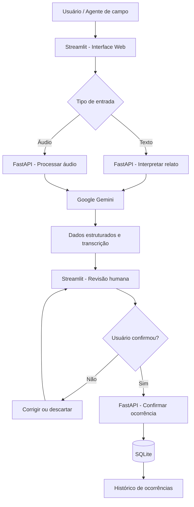

# 🛣️ ROUTE AI

### Intelligent Road Operations Assistant

**Assistente inteligente para apoio às operações rodoviárias, utilizando Inteligência Artificial Generativa, processamento de áudio e automação de registros operacionais.**


> **Status:** MVP funcional em desenvolvimento  
> **Contexto:** Challenge FIAP × Motiva  
> **Área:** Generative AI | AI Engineering | Backend Development | Process Automation

---

## 📌 Sobre o projeto

O **ROUTE AI** é um projeto de Inteligência Artificial desenvolvido no contexto do desafio acadêmico proposto pela **Motiva**, com o objetivo de explorar como agentes inteligentes podem apoiar profissionais que atuam em operações rodoviárias.

A proposta surgiu de um problema prático: durante o atendimento de ocorrências, profissionais em campo precisam observar o ambiente, comunicar informações e realizar registros operacionais.

Dependendo da situação, preencher manualmente esses registros pode consumir tempo e exigir interações adicionais com sistemas.

O ROUTE AI busca simplificar parte desse processo por meio de uma interface que permite ao usuário **descrever uma ocorrência por voz ou texto**, enquanto a IA interpreta o relato e organiza automaticamente as informações relevantes.

Antes de qualquer registro definitivo, o usuário pode revisar, corrigir e confirmar os dados.

O projeto está sendo desenvolvido de forma incremental, começando por um MVP de registro inteligente de ocorrências e evoluindo futuramente para outras funcionalidades de apoio operacional.

---

## 🎯 Objetivo

Desenvolver um assistente inteligente capaz de transformar relatos em linguagem natural em registros estruturados de ocorrências rodoviárias.

O sistema busca:

- Reduzir a necessidade de digitação durante o registro de ocorrências.
- Permitir interações por texto e áudio.
- Interpretar informações operacionais utilizando IA generativa.
- Identificar automaticamente rodovia, quilômetro, sentido e descrição.
- Possibilitar revisão e confirmação humana antes do registro.
- Armazenar ocorrências e disponibilizar um histórico consultável.
- Servir como base para futuras funcionalidades de assistência operacional.

**Princípio central:** a Inteligência Artificial auxilia na interpretação e organização das informações, mas não substitui o profissional nas decisões operacionais.

---

## 💡 Como funciona?

O usuário pode relatar uma ocorrência utilizando texto ou gravando um áudio diretamente na aplicação.

**Exemplo de relato:**

> "Estou na Rodovia Anhanguera, km 35, sentido capital. Encontrei um carro encostado no acostamento."

A IA interpreta o relato e retorna os dados estruturados:

```json
{
  "rodovia": "Rodovia Anhanguera",
  "km": 35.0,
  "sentido": "capital",
  "descricao": "Carro encostado no acostamento"
}
```

Essas informações são apresentadas em um formulário editável.

O registro somente é enviado ao banco de dados após a confirmação explícita do usuário.

Quando alguma informação não é mencionada, o sistema procura preservar sua ausência em vez de inventar um valor.

---

## ✅ Funcionalidades implementadas

### 1. Interpretação de ocorrências por texto

O usuário descreve uma situação em linguagem natural.

A aplicação envia o relato para o backend, que utiliza o Google Gemini para identificar e estruturar as informações.

**Campos extraídos:**

- Rodovia
- Quilômetro
- Sentido
- Descrição da ocorrência

### 2. Gravação de áudio pelo navegador

O usuário pode gravar seu relato diretamente na interface web, utilizando o microfone do dispositivo.

Também existe a opção de enviar um arquivo de áudio.

Isso evita a necessidade de gravar o relato em outro aplicativo antes de utilizá-lo no sistema.

### 3. Transcrição e interpretação com IA

O áudio é encaminhado ao backend para processamento pelo Gemini.

A aplicação retorna:

- Transcrição do relato.
- Dados estruturados da ocorrência.
- Informações para revisão e confirmação.

A implementação atual utiliza um fluxo otimizado que busca reduzir chamadas sequenciais ao modelo.

### 4. Revisão e confirmação humana

Antes do registro, o usuário pode:

- Conferir as informações identificadas pela IA.
- Corrigir campos incorretos.
- Complementar informações ausentes.
- Confirmar explicitamente o registro.

Essa etapa evita que a interpretação do modelo seja tratada automaticamente como um fato validado.

### 5. Persistência de dados com SQLite

Após a confirmação, a ocorrência é armazenada em um banco de dados SQLite.

Os registros possuem identificador próprio e informações associadas à ocorrência.

### 6. Histórico de ocorrências

A aplicação disponibiliza uma tabela com os registros armazenados.

É possível consultar:

- ID da ocorrência.
- Rodovia.
- Quilômetro.
- Sentido.
- Descrição.
- Data e hora do registro.

---

## 🏗️ Arquitetura da solução

O projeto utiliza uma arquitetura cliente-servidor, separando interface, processamento e persistência.



### Responsabilidades

| Componente | Responsabilidade |
|---|---|
| Streamlit | Interface web, entrada de dados, gravação de áudio e revisão |
| FastAPI | Endpoints, validação, integração com serviços e persistência |
| Google Gemini | Transcrição, interpretação e extração estruturada |
| Pydantic | Definição e validação dos modelos de dados |
| SQLite | Armazenamento das ocorrências confirmadas |
| Requests | Comunicação HTTP entre Streamlit e FastAPI |

---

## 🛠️ Tecnologias utilizadas

**Python:** linguagem principal do projeto.

**FastAPI:** framework utilizado na construção do backend e dos endpoints REST.

**Streamlit:** framework responsável pela interface web interativa.

**Google Gemini API:** modelo generativo utilizado no processamento dos relatos.

**Pydantic:** validação e estruturação dos dados recebidos e retornados pela API.

**SQLite:** banco de dados relacional utilizado na persistência local.

**python-dotenv:** carregamento de variáveis de ambiente, incluindo credenciais da API.

---

## 📁 Estrutura do projeto

Estrutura principal da aplicação:

```text
route-ai/
│
├── app/
│   ├── __init__.py
│   ├── main.py
│   ├── ai_service.py
│   ├── voice_service.py
│   └── database.py
│
├── streamlit_app.py
├── requirements.txt
├── .env
├── .gitignore
├── README.md
└── route_ai.db
```

**Descrição dos arquivos:**

- `main.py`: endpoints e regras da API.
- `ai_service.py`: interpretação de relatos e extração de informações.
- `voice_service.py`: processamento de áudio com IA.
- `database.py`: inicialização do banco, persistência e consultas.
- `streamlit_app.py`: interface da aplicação.
- `requirements.txt`: dependências do projeto.
- `.env`: variáveis de ambiente locais.

O arquivo `.env` e o banco local não devem ser publicados com dados sensíveis ou credenciais.

---

## 🚀 Executando o projeto localmente

### Pré-requisitos

- Python instalado.
- Chave de API do Google Gemini.
- Dependências Python do projeto.

### 1. Clonar o repositório

```bash
git clone <URL_DO_REPOSITORIO>
cd <PASTA_DO_PROJETO>
```

### 2. Criar o ambiente virtual

```bash
python -m venv .venv
```

No Windows (PowerShell):

```powershell
.\.venv\Scripts\Activate.ps1
```

### 3. Instalar as dependências

```bash
pip install -r requirements.txt
```

### 4. Configurar as variáveis de ambiente

Crie um arquivo `.env` na raiz do projeto:

```env
GEMINI_API_KEY=sua_chave_aqui
```

**Importante:** nunca publique sua chave de API no GitHub.

### 5. Iniciar o backend

No terminal:

```bash
uvicorn app.main:app --reload
```

A API estará disponível em:

```text
http://127.0.0.1:8000
```

A documentação interativa do FastAPI poderá ser acessada em:

```text
http://127.0.0.1:8000/docs
```

### 6. Iniciar a interface web

Em outro terminal, com o ambiente virtual ativado:

```bash
streamlit run streamlit_app.py
```

A aplicação será aberta no navegador, normalmente em:

```text
http://localhost:8501
```

---

## 🔌 Endpoints da API

| Método | Endpoint | Descrição |
|---|---|---|
| GET | `/` | Verifica a disponibilidade da API |
| POST | `/ocorrencias/interpretar` | Interpreta um relato textual |
| POST | `/ocorrencias/audio` | Processa áudio e retorna informações extraídas |
| POST | `/ocorrencias/confirmar` | Registra uma ocorrência confirmada |
| GET | `/ocorrencias` | Lista ocorrências armazenadas |

O endpoint de confirmação exige autorização explícita no corpo da requisição por meio do campo `confirmado`.

---

## 🧪 Testes realizados

Durante o desenvolvimento, foram realizados testes para verificar o comportamento da aplicação e corrigir problemas de integração.

Entre os cenários trabalhados estão:

- Interpretação de relatos textuais.
- Extração de informações estruturadas.
- Gravação de áudio pelo navegador.
- Processamento de arquivos de áudio.
- Validação dos campos recebidos pelo backend.
- Tratamento de informações ausentes.
- Confirmação e armazenamento de ocorrências.
- Consulta ao histórico de registros.

### Teste de processamento de áudio

Em um dos testes mais recentes, foi utilizada uma gravação de aproximadamente **8 segundos**.

**Resultado observado:**

| Métrica | Resultado |
|---|---|
| Duração do áudio | 8 segundos |
| Tempo total de processamento | 22,01 segundos |
| Resposta da API | HTTP 200 OK |
| Transcrição | Realizada |
| Extração estruturada | Realizada |
| Revisão dos dados | Disponibilizada |

O teste demonstrou o funcionamento do fluxo de áudio até a etapa de revisão.

Entretanto, a latência ainda precisa ser avaliada em múltiplas execuções, e a confirmação de persistência deve ser novamente validada após a otimização do processamento.

**Observação:** esses resultados representam um teste específico, não uma média de desempenho ou benchmark definitivo.

---

## 🗺️ Roadmap de desenvolvimento

### Fase 1 — MVP de registro inteligente

- [x] Estruturar backend com FastAPI.
- [x] Integrar modelo generativo.
- [x] Interpretar relatos por texto.
- [x] Extrair dados estruturados.
- [x] Criar interface com Streamlit.
- [x] Implementar confirmação humana.
- [x] Persistir ocorrências com SQLite.
- [x] Criar histórico de registros.

### Fase 2 — Interação por voz

- [x] Implementar upload de áudio.
- [x] Permitir gravação diretamente pelo navegador.
- [x] Integrar transcrição e interpretação com IA.
- [x] Implementar fluxo otimizado de processamento.
- [ ] Validar integralmente a persistência após o fluxo otimizado.
- [ ] Realizar testes comparativos de latência.
- [ ] Melhorar feedback visual durante o processamento.
- [ ] Avaliar estratégias adicionais de redução de latência.

### Fase 3 — Evolução do assistente

- [ ] Consultar procedimentos operacionais aprovados.
- [ ] Implementar recuperação de conhecimento com RAG.
- [ ] Ampliar o suporte a comandos de voz.
- [ ] Implementar autenticação e controle de acesso.
- [ ] Melhorar rastreabilidade e auditoria das ações.
- [ ] Avaliar suporte a conectividade instável e operação offline limitada.
- [ ] Integrar futuramente sistemas operacionais autorizados.

### Fase 4 — Produto e apresentação

- [ ] Aprimorar a experiência da interface.
- [ ] Criar testes automatizados.
- [ ] Documentar métricas e limitações.
- [ ] Preparar uma demonstração do sistema.
- [ ] Avaliar possibilidades de deploy.
- [ ] Documentar arquitetura e decisões técnicas.

---

## 🔐 Segurança e responsabilidade

O ROUTE AI foi concebido como uma ferramenta de apoio ao profissional, não como um sistema autônomo de tomada de decisões operacionais.

No MVP atual, o registro depende da confirmação humana.

Para uma eventual utilização em ambiente real, ainda seriam necessários mecanismos adicionais, como autenticação, autorização, auditoria, proteção de dados, integração segura com sistemas corporativos e validação operacional.

O sistema não realiza automaticamente acionamento de equipes de emergência, despacho de recursos ou decisões críticas.

A operação centralizada do Centro de Controle Operacional (CCO) não faz parte do escopo implementado neste MVP.

---

## 📚 Aprendizados técnicos

O desenvolvimento do ROUTE AI permite aplicar conhecimentos de:

- Engenharia de software com Python.
- Construção e consumo de APIs REST.
- Integração com modelos de linguagem.
- Processamento de áudio com IA generativa.
- Extração estruturada de informações.
- Validação de dados com Pydantic.
- Persistência em bancos relacionais.
- Tratamento de erros HTTP e exceções.
- Gerenciamento de estado em aplicações Streamlit.
- Medição e otimização de latência.
- Desenvolvimento incremental e depuração de sistemas.

Além da integração com IA, o projeto envolve desafios práticos de engenharia, especialmente na comunicação entre componentes, no tratamento de dados incompletos e na confiabilidade do fluxo de registro.

---

## 🎓 Contexto acadêmico

O ROUTE AI está sendo desenvolvido como projeto acadêmico no contexto do **Challenge FIAP × Motiva**.

A solução busca explorar aplicações de Inteligência Artificial Generativa para apoiar profissionais em operações rodoviárias.

O desenvolvimento apresentado neste repositório é um protótipo acadêmico e não representa uma solução oficialmente implantada nos sistemas da Motiva.

---

## 📌 Status atual

O ROUTE AI possui um MVP funcional, executado localmente, que demonstra a integração entre interface web, backend, IA generativa e banco de dados.

O foco atual do desenvolvimento é **melhorar a confiabilidade e a velocidade do processamento de áudio**, validar o fluxo completo após as otimizações e evoluir a experiência do usuário.

O projeto continuará sendo atualizado conforme novas funcionalidades forem desenvolvidas, implementadas e testadas.

---

**ROUTE AI — Exploring how Generative AI can support real-world operations.**
